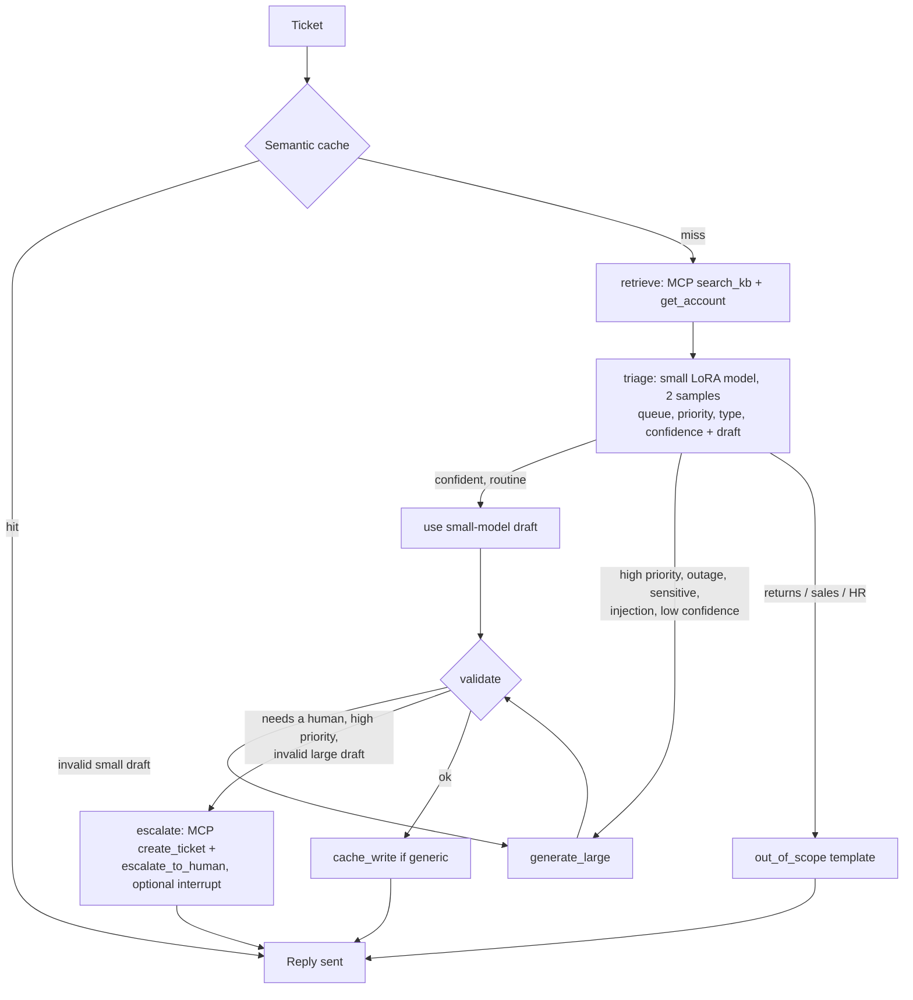

# Fluxo support agent: LLMOps & Agentic Systems

A customer-support agent for **Fluxo**, a fictional B2B SaaS platform, built for the mutualised project
*LLMOps & Agentic Systems* (Agentic Workflows + MSA-DAT07-04 Data & AI Product).

The agent triages each ticket (queue, priority, type), drafts a reply, and sends risky or failed cases to a larger
model or to a human. It is a **LangGraph** workflow; the help center, the CRM and the ticketing actions sit behind an
**MCP server**. A small open model is **fine-tuned with LoRA** on the
[Tobi-Bueck customer-support-tickets](https://huggingface.co/datasets/Tobi-Bueck/customer-support-tickets) dataset,
and an **evaluation harness of 200 triples** runs in CI.

| Course deliverable | Where |
| --- | --- |
| LoRA fine-tuning of a small open LLM on support dialogues | `finetune/` |
| Automated evaluation harness, 200 test triples, CI-integrated | `eval/`, `.github/workflows/eval.yml` |
| Monitoring of latency, cost, quality | `src/support_agent/monitoring.py`, `monitoring/` |
| Model routing | `src/support_agent/routing.py`, node `triage` |
| Semantic caching | `src/support_agent/cache.py`, nodes `cache_lookup` / `cache_write` |
| Production readiness checklist | `PRODUCTION_CHECKLIST.md` |

## Architecture



- **State** (`state.py`): ticket, retrieved articles, account, triage, route, draft, validation errors, status, and
  a `metrics` list with one row per node (latency, model, tokens, cost).
- **MCP server** (`mcp_server/server.py`): `search_kb`, `get_article`, `get_account`, `list_invoices` (read),
  `create_ticket`, `escalate_to_human` (write, idempotent). Annotations, constrained arguments and typed errors as in
  course lab 2. The graph calls it in-process by default, or over stdio with `MCP_TRANSPORT=stdio`.
- **Routing rules** (`routing.py`) are pure functions, unit-tested without a model.
- **Human in the loop**: with `HUMAN_IN_THE_LOOP=1`, escalated tickets pause on `interrupt()` until an agent
  approves or edits the reply (SQLite checkpointer in the CLI, Studio's own in `langgraph dev`).

## Quick start (offline, no key, no GPU)

Everything runs with **mock models** by default (keyword rules), so you can check the plumbing first.

```bash
uv sync --extra dev
uv run pytest -q                                              # 37 tests
uv run python scripts/prepare_data.py --sample                # 48 hand-written demo tickets
uv run python eval/build_triples.py --sample                  # 43 demo triples
uv run python eval/run_eval.py --out eval/runs/demo           # the whole pipeline on mock models
uv run python -m support_agent.cli "Application down" "We only get a 503 page, the whole team is blocked."
```

Mock scores are a rules baseline, not results.

## Real setup

```bash
cp .env.example .env         # OPENROUTER_API_KEY, model names
uv sync --extra dev --extra data --extra embeddings --extra dashboard
uv run python scripts/seed_crm.py --reset
```

| Role | Default | Variables |
| --- | --- | --- |
| small model (the LoRA) | Ollama `fluxo-support-lora` | `SMALL_PROVIDER`, `SMALL_MODEL`, `SMALL_BASE_URL` |
| large model | DeepSeek v4.1 Flash on OpenRouter | `LARGE_*` |
| judge | Gemini 2.5 Flash on OpenRouter (another family) | `JUDGE_*` |

Before the LoRA exists, use the base model as small model (`SMALL_MODEL=qwen2.5:3b` in Ollama).

## Pipeline (matches the task table of the project doc)

```bash
# 1. data: clean labels, dedupe, stratified split            -> data/processed/, stats.json
uv run python scripts/prepare_data.py
# 2. evaluation set: 200 triples + 40 smoke triples           -> eval/triples.jsonl, eval/triples_smoke.jsonl
uv run python eval/build_triples.py
# 3. reference: large model only, no cache                     -> eval/runs/reference, then copy summary to eval/baseline.json
SMALL_PROVIDER=openrouter SMALL_MODEL=deepseek/deepseek-v4.1-flash CACHE_ENABLED=0 \
  uv run python eval/run_eval.py --out eval/runs/reference
# 4. LoRA: see finetune/README.md (build_sft.py, train_lora.py on a GPU, export to Ollama)
# 5. calibrate the thresholds from data
uv run python eval/calibrate.py cache --triples eval/triples.jsonl          # -> CACHE_THRESHOLD
uv run python eval/calibrate.py router --run eval/runs/system               # -> ROUTE_CONFIDENCE
uv run python eval/calibrate.py judge --run eval/runs/system --labels eval/judge_labels.jsonl
# 6. full system
uv run python eval/run_eval.py --out eval/runs/system
# 7. record the smoke run for CI replay, then commit eval/recordings/ and eval/baseline_smoke.json
LLM_MODE=record uv run python eval/run_eval.py --triples eval/triples_smoke.jsonl --out eval/runs/smoke
cp eval/runs/smoke/summary.json eval/baseline_smoke.json
```

## Experiments (fill in from `eval/runs/*/summary.csv`)

| Variant | Command | Triage exact | Judge score | Escalation recall (critical) | Cost / ticket | Latency p95 |
| --- | --- | ---: | ---: | ---: | ---: | ---: |
| Base small model, prompt only | `--variant raw_small`, `SMALL_MODEL=<base>` | | | n/a | | |
| LoRA alone | `--variant raw_small`, `SMALL_MODEL=fluxo-support-lora` | | | n/a | | |
| Large model only (reference) | step 3 above | | | | | |
| Full system (LoRA + routing + cache) | `--variant graph` | | | | | |

Compare two runs with a paired bootstrap: `uv run python eval/summary.py compare eval/runs/A eval/runs/B`.

## Evaluation and CI

- **Triples** (`eval/build_triples.py`): 120 routine, 30 critical, 20 paraphrases (cache), 15 out of scope,
  15 prompt injections, all from the test split that the LoRA never sees.
- **Metrics** (`eval/summary.py`): accuracy and macro-F1 per label, LLM-judge score with a bootstrap interval,
  escalation recall on critical tickets, redirect accuracy, leak rate, cache hit rate, small-model share,
  cost and latency.
- **CI** (`.github/workflows/eval.yml`):
  1. every PR: unit tests + the whole pipeline on mock models, checked against `eval/baseline_ci.json`;
  2. every PR, once recordings are committed: the 40 smoke triples replayed from `eval/recordings/` (free,
     deterministic), checked against `eval/baseline_smoke.json`;
  3. nightly: the 200 triples with real models (`OPENROUTER_API_KEY` secret), checked against `eval/baseline.json`.
- **Blocking thresholds** (`eval/thresholds.json`): 100 % escalation of critical tickets, 100 % redirects,
  0 leaks, ≤ 2 % errors, no drop of more than 2 points versus the baseline, cost ≤ 1.25 × baseline.

## Monitoring

Every ticket answered through the CLI appends one line to `runs/metrics.jsonl`.

```bash
uv run python monitoring/report.py --since-hours 24      # KPIs + alerts (exit code 2 on alert)
uv run streamlit run monitoring/dashboard.py             # latency per node, cost, cache, routing, judge
```

## Project structure

```
src/support_agent/   config, prompts, llm (record/replay/mock), state, nodes, routing, graph, cache,
                     embeddings, tools (MCP gateway), monitoring, cli, data
  mcp_server/        server.py (MCP), kb.py (help-center search), crm.py (SQLite CRM)
data/                kb/ (17 Fluxo articles), sample_tickets.jsonl (48 hand-written demo tickets)
eval/                build_triples, run_eval, judge, metrics, summary, calibrate, thresholds, baselines
finetune/            build_sft, train_lora, Modelfile, README
monitoring/          report.py, dashboard.py
tests/               offline tests (mock models)
```

## Limitations

- The tickets are probably synthetic and not SaaS-specific; their reference replies are generic. The judge prompt
  allows a more specific reply when it is supported, and must be calibrated on our own labels.
- Fluxo, its help center and its CRM are fictional; replies are grounded in them, not in the dataset.
- Dataset licence CC BY-NC 4.0: academic use only.
- The default cache embedder is a hashing embedder (no download); switch to `EMBEDDER=e5` and recalibrate.

## Team

| Member | Scope |
| --- | --- |
| Member A | data, LoRA, evaluation and CI |
| Member B | agent, MCP tools, routing, cache, monitoring |
